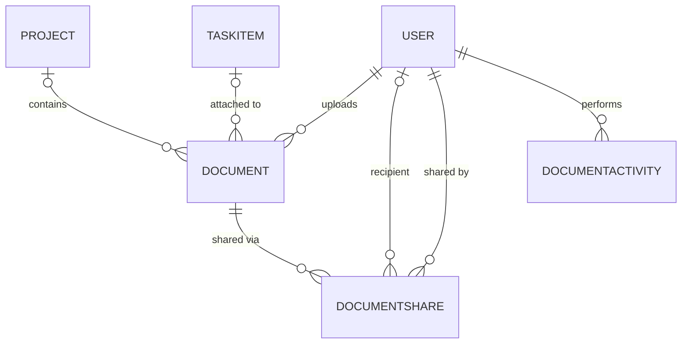

# Data Model: Document Upload and Management

**Feature**: [spec.md](spec.md) | **Research**: [research.md](research.md) | **Date**: 2026-10-20

The conventions follow the existing models: integer keys, DataAnnotations plus explicit configuration in `ApplicationDbContext`, UTC timestamps, and text values where readability matters.

## Entity: Document (new)

| Field | Type | Constraints | Notes |
|---|---|---|---|
| DocumentId | int | PK, identity | |
| Title | string | Required, max 255 | Defaults to the file name without extension on upload (Q4); editable |
| Description | string? | max 2000 | Optional |
| Category | string | Required, max 50, ∈ `DocumentCategories.All` | Text: Project Documents, Team Resources, Personal Files, Reports, Presentations, Other |
| Tags | string? | max 500 | Normalized `,tag1,tag2,` (lowercase, trimmed, de-duplicated) |
| OriginalFileName | string | Required, max 255 | Display and download name only; never used in paths |
| FilePath | string | Required, max 500, unique | Relative storage key `{userId}/{projectId\|personal}/{guid}{ext}` |
| FileType | string | Required, max 255 | MIME type (long Office types fit) |
| FileExtension | string | Required, max 10 | Lowercased, whitelisted (e.g., `.pdf`) |
| FileSizeBytes | long | Required, 1 to 26,214,400 | |
| UploadedByUserId | int | Required, FK → User | Restrict delete |
| UploadedDate | DateTime | Required (UTC) | |
| UpdatedDate | DateTime | Required (UTC) | Set on metadata edit and file replace |
| ProjectId | int? | FK → Project | Restrict delete |
| TaskId | int? | FK → TaskItem | Restrict delete. When set, ProjectId = Task.ProjectId (FR-025) |

**Indexes**: `UploadedByUserId`, `ProjectId`, `TaskId`, `UploadedDate`, `Category`, unique on `FilePath`.

**Navigation**: `UploadedBy` (User), `Project?`, `Task?`, `Shares` (ICollection<DocumentShare>, cascade delete).

**Validation rules**:
- Allowed extensions: `.pdf .doc .docx .xls .xlsx .ppt .pptx .txt .jpg .jpeg .png` (FR-002).
- Size must be ≤ 25 MB (26,214,400 bytes). Exactly 25 MB is accepted (edge case).
- Title is required and must not be blank after trimming (FR-004).
- Category must be in the fixed list (FR-004).
- If ProjectId is set, the uploader must be the PM or a member of that project, unless Administrator (FR-017).
- If TaskId is set, the task's project must be visible to the uploader, and ProjectId is forced to the task's ProjectId.
- The content must pass `IMalwareScanner` (FR-006).

## Entity: DocumentShare (new)

| Field | Type | Constraints | Notes |
|---|---|---|---|
| DocumentShareId | int | PK, identity | |
| DocumentId | int | Required, FK → Document | Cascade delete (removes from Shared with Me on delete) |
| SharedWithUserId | int? | FK → User | Exactly one of SharedWithUserId / SharedWithDepartment is set |
| SharedWithDepartment | string? | max 100 | Matches `User.Department` (case-insensitive compare) |
| SharedByUserId | int | Required, FK → User | Restrict delete |
| SharedDate | DateTime | Required (UTC) | |

**Indexes**: unique `(DocumentId, SharedWithUserId)` filtered on non-null, unique `(DocumentId, SharedWithDepartment)` filtered on non-null, `SharedWithUserId`, `SharedWithDepartment`.

**Constraint**: check constraint `(SharedWithUserId IS NULL) <> (SharedWithDepartment IS NULL)`.

**Rules**: Only the uploader may create shares (FR-023). Shares grant read-only access (Q5). A department share applies to the department's *current* members, evaluated at access time.

## Entity: DocumentActivity (new, audit)

| Field | Type | Constraints | Notes |
|---|---|---|---|
| DocumentActivityId | int | PK, identity | |
| DocumentId | int | Required, **no FK** | Survives document deletion |
| DocumentTitle | string | Required, max 255 | Snapshot |
| FileType | string | Required, max 255 | Snapshot (for the "most uploaded types" report) |
| UserId | int | Required, FK → User | Actor; restrict delete |
| Action | string | Required, max 20 | `Upload`, `Download`, `Preview`, `Replace`, `Delete`, `Share` |
| Details | string? | max 500 | e.g., share target |
| Timestamp | DateTime | Required (UTC) | |

**Indexes**: `(Action, Timestamp)`, `UserId`, `DocumentId`.

## Changes to existing types

- **NotificationType** (enum): append `DocumentShared` and `DocumentAdded` at the end, keeping existing integer values stable.
- **ApplicationDbContext**: add `DbSet<Document> Documents`, `DbSet<DocumentShare> DocumentShares`, and `DbSet<DocumentActivity> DocumentActivities`, plus the relationships and indexes above. No seed documents (files would not exist on disk).
- **Login claims**: add `Department` (custom claim type `"department"`) for UI display. Authorization reads the department from the database.
- **DashboardSummary**: add `DocumentCount` (documents uploaded by the user).

## Relationships

## State and lifecycle

A document has no workflow states. The lifecycle is:

1. **Upload**: validate → authorize → scan → store file → insert record → log `Upload` → notify project members (excluding the uploader).
2. **Edit metadata**: update fields and `UpdatedDate`.
3. **Replace**: validate and scan → store new file → update `FilePath`, `FileType`, `FileExtension`, `FileSizeBytes`, `OriginalFileName`, `UpdatedDate` → delete old file → log `Replace`.
4. **Share**: insert share rows (skip duplicates) → notify new recipients → log `Share`.
5. **Delete** (confirmed): delete the record (cascading to shares) → delete the file → log `Delete`. Deletion is permanent.
