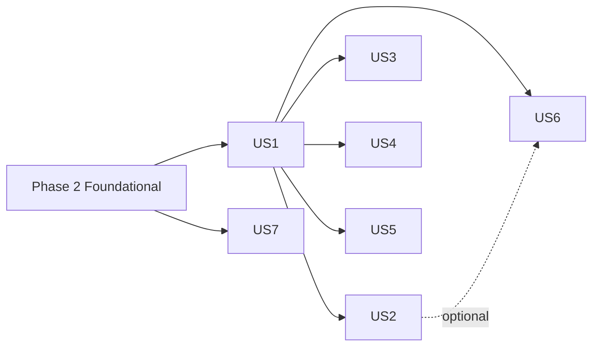

---

description: "Task list for Document Upload and Management"
---

# Tasks: Document Upload and Management

**Input**: Design documents from `specs/001-document-management/`
**Prerequisites**: [plan.md](plan.md), [spec.md](spec.md), [research.md](research.md), [data-model.md](data-model.md), [contracts/](contracts/), [quickstart.md](quickstart.md)

**Tests**: Included. [plan.md](plan.md) and [research.md](research.md) R11 commit to a `ContosoDashboard.Tests` xUnit project covering the authorization matrix (SC-009), upload/delete consistency (SC-010), the malware scanner, and storage path safety. Test tasks appear first in each story and should fail before their implementation tasks are done.

**Organization**: Tasks are grouped by user story (US1–US7 from [spec.md](spec.md)) so each story can be implemented and tested independently.

## Format: `[ID] [P?] [Story] Description`

- **[P]**: Can run in parallel (different files, no dependency on incomplete tasks)
- **[Story]**: The user story the task belongs to (US1–US7)
- Paths are relative to the repository root `ContosoDashboard-SSD/`

## Path Conventions

- Web app: `ContosoDashboard/` (Models, Data, Services, Pages, Shared)
- Tests: `ContosoDashboard.Tests/` (sibling project, run with `dotnet test ContosoDashboard.Tests`)

---

## Phase 1: Setup (Shared Infrastructure)

**Purpose**: Configuration and test project scaffolding

- [ ] T000a Create and switch to branch `001-document-management` (`git checkout -b 001-document-management`); all feature commits go to this branch
- [ ] T001 [P] Add `**/AppData/` to `.gitignore` so uploaded files are never committed
- [ ] T002 [P] Add a `"DocumentStorage": { "RootPath": "AppData/uploads", "MaxFileSizeBytes": 26214400 }` section to `ContosoDashboard/appsettings.json`
- [ ] T003 [P] Create the xUnit test project `ContosoDashboard.Tests/ContosoDashboard.Tests.csproj` targeting `net10.0`:
  - Package references: `Microsoft.NET.Test.Sdk`, `xunit`, `xunit.runner.visualstudio`, `Microsoft.EntityFrameworkCore.Sqlite` (10.0.13)
  - `<ProjectReference Include="../ContosoDashboard/ContosoDashboard.csproj" />`
- [ ] T004 Create a test helper `ContosoDashboard.Tests/TestDb.cs`:
  - Opens a shared in-memory SQLite connection (`DataSource=:memory:`) and builds an `ApplicationDbContext` with `EnsureCreated()`, so the 4 seeded users and project 1 are available.
  - Exposes helpers: add a user (role, department), add a project (PM ID), add a project member, add a `Document` row directly.
  - Provides an `InMemoryFileStorageService : IFileStorageService` fake with a toggle to throw on upload (depends on T003)

---

## Phase 2: Foundational (Blocking Prerequisites)

**Purpose**: Entities, schema, storage and scanner abstractions, the shared access predicate, and DI wiring that every story depends on

**⚠️ CRITICAL**: No user story work can begin until this phase is complete

### Models and schema

- [ ] T005 [P] Create `ContosoDashboard/Models/DocumentCategories.cs`:
  - Static class with constants `ProjectDocuments = "Project Documents"`, `TeamResources = "Team Resources"`, `PersonalFiles = "Personal Files"`, `Reports = "Reports"`, `Presentations = "Presentations"`, `Other = "Other"`
  - `IReadOnlyList<string> All`
  - `bool IsValid(string)` using an ordinal comparison
  - In the same file, a static class `DocumentFileTypes` with `IReadOnlyDictionary<string,string> Map` (extension → canonical MIME type, per [research.md](research.md) R5) and `bool IsAllowed(string ext)`
- [ ] T006 [P] Create `ContosoDashboard/Models/Document.cs` per [data-model.md](data-model.md). DataAnnotations:
  - `DocumentId` int [Key]
  - `Title` string "Required, max 255"
  - `Description` string? "max 2000"
  - `Category` string "Required, max 50"
  - `Tags` string? "max 500" (normalized `,tag1,tag2,`)
  - `OriginalFileName` string "Required, max 255"
  - `FilePath` string "Required, max 500, unique"
  - `FileType` string "Required, max 255"
  - `FileExtension` string "Required, max 10"
  - `FileSizeBytes` long
  - `UploadedByUserId` int (Required, FK → User)
  - `UploadedDate` DateTime (UTC)
  - `UpdatedDate` DateTime (UTC)
  - `ProjectId` int? (FK → Project)
  - `TaskId` int? (FK → TaskItem)
  - Navigations: `UploadedBy`, `Project?`, `Task?`, `ICollection<DocumentShare> Shares`
- [ ] T007 [P] Create `ContosoDashboard/Models/DocumentShare.cs`:
  - `DocumentShareId` int [Key]
  - `DocumentId` int (Required, FK → Document)
  - `SharedWithUserId` int? (FK → User)
  - `SharedWithDepartment` string? "max 100"
  - `SharedByUserId` int (Required, FK → User)
  - `SharedDate` DateTime (UTC)
  - Navigations: `Document`, `SharedWithUser?`, `SharedByUser`
- [ ] T008 [P] Create `ContosoDashboard/Models/DocumentActivity.cs`:
  - `DocumentActivityId` int [Key]
  - `DocumentId` int (Required, **no FK**, so records survive deletion)
  - `DocumentTitle` string "Required, max 255"
  - `FileType` string "Required, max 255"
  - `UserId` int (Required, FK → User)
  - `Action` string "Required, max 20" with values `Upload`, `Download`, `Preview`, `Replace`, `Delete`, `Share` (define as constants in a static `DocumentActions` class in the same file)
  - `Details` string? "max 500"
  - `Timestamp` DateTime (UTC)
- [ ] T009 [P] Append `DocumentShared` and `DocumentAdded` to the **end** of the `NotificationType` enum in `ContosoDashboard/Models/Notification.cs`, keeping existing integer values stable
- [ ] T010 Update `ContosoDashboard/Data/ApplicationDbContext.cs` (depends on T006–T008):
  - Add `DbSet<Document> Documents`, `DbSet<DocumentShare> DocumentShares`, `DbSet<DocumentActivity> DocumentActivities`.
  - Configure Document → User/Project/TaskItem FKs with `DeleteBehavior.Restrict`, and Document → Shares with `Cascade`.
  - Configure DocumentShare → SharedWithUser/SharedByUser with `Restrict`, and DocumentActivity → User with `Restrict`.
  - Indexes on Document: `UploadedByUserId`, `ProjectId`, `TaskId`, `UploadedDate`, `Category`, unique `FilePath`.
  - Indexes on DocumentShare: unique `(DocumentId, SharedWithUserId)` filtered `SharedWithUserId IS NOT NULL`, unique `(DocumentId, SharedWithDepartment)` filtered `SharedWithDepartment IS NOT NULL`, `SharedWithUserId`, `SharedWithDepartment`.
  - Check constraint `CK_DocumentShare_Target`: `(SharedWithUserId IS NULL) <> (SharedWithDepartment IS NULL)`.
  - Indexes on DocumentActivity: `(Action, Timestamp)`, `UserId`, `DocumentId`.
  - No document seed data.

### Infrastructure abstractions (constitution principle III)

- [ ] T011 [P] Create `ContosoDashboard/Services/IFileStorageService.cs` per [contracts/service-interfaces.md](contracts/service-interfaces.md):
  - `UploadAsync(Stream, string storageKey, string contentType)`, `DownloadAsync(string)`, `DeleteAsync(string)`, `GetUrlAsync(string, TimeSpan)`
  - A `DocumentStorageOptions` class (`RootPath`, `MaxFileSizeBytes = 26214400`) in the same file
- [ ] T012 Implement `ContosoDashboard/Services/LocalFileStorageService.cs` (depends on T011):
  - Resolve the root against `IWebHostEnvironment.ContentRootPath` and create the directory if missing.
  - For every key, compute `Path.GetFullPath(Path.Combine(root, key))` and throw `InvalidOperationException` if the result is not under root.
  - `DownloadAsync` throws `FileNotFoundException` when the file is missing. `DeleteAsync` is a no-op when the file is missing.
  - `GetUrlAsync` returns the key (local implementation is unused by the UI).
- [ ] T013 [P] Create `ContosoDashboard/Services/IMalwareScanner.cs` with `Task<ScanResult> ScanAsync(Stream content, string fileExtension)` and `public record ScanResult(bool IsClean, string? Reason)`
- [ ] T014 Implement `ContosoDashboard/Services/LocalMalwareScanner.cs` per [research.md](research.md) R3 (depends on T013):
  - Reject content containing the EICAR signature.
  - Enforce magic bytes per extension:
    - `.pdf` starts with `%PDF-`
    - `.png` starts with `89 50 4E 47 0D 0A 1A 0A`
    - `.jpg`/`.jpeg` start with `FF D8 FF`
    - `.docx`/`.xlsx`/`.pptx` start with `50 4B 03 04`
    - `.doc`/`.xls`/`.ppt` start with `D0 CF 11 E0 A1 B1 1A E1`
    - `.txt` has no `0x00` byte in the first 8 KB
  - Always reset `content.Position = 0` before returning.

### Shared document service core (constitution principle II)

- [ ] T015 Create `ContosoDashboard/Services/DocumentService.cs` with the full `IDocumentService` interface and all DTOs from [contracts/service-interfaces.md](contracts/service-interfaces.md). DTOs: `FileUpload`, `UploadBatchRequest`, `UploadResult`, `FileError`, `DocumentQuery`, `DocumentSummary`, `DocumentMetadataUpdate`, `ShareRequest`, `DocumentContent`, `OperationResult`.
  - Add the `DocumentService` class with a constructor taking `ApplicationDbContext`, `IFileStorageService`, `IMalwareScanner`, `INotificationService`, `IOptions<DocumentStorageOptions>`, `ILogger<DocumentService>`. Unimplemented methods throw `NotImplementedException` for now.
  - Implement the private helpers:
    - (a) `LoadUserAsync(int userId)`: reads `Role` and `Department` from the DB, not from claims.
    - (b) `IQueryable<Document> VisibleTo(User u)`: an EF-translatable predicate per [research.md](research.md) R6. Administrator sees all. Otherwise visible when any of these holds:
      - uploader
      - the project's PM or a project member
      - a share to the user's ID
      - a share to the user's department (case-insensitive)
      - TeamLead whose department equals the uploader's department and `Category != "Personal Files"`
    - (c) `CanManage(doc, user)`: Administrator, uploader, PM of the doc's project, or a same-department TeamLead when the category is not Personal Files.
    - (d) `CanReplace` = uploader or Administrator.
    - (e) `CanShare` = uploader.
    - (f) `ToSummary` projection that fills the `Can*` flags and `CanPreview` (extension in `.pdf .png .jpg .jpeg`).
    - (g) `LogActivityAsync(Document, int userId, string action, string? details)`.
    - (h) `NormalizeTags(string?)` → `,a,b,` (lowercase, trimmed, distinct) or null.
    - (i) `EscapeLike(string)` for `%`, `_`, `\`.
- [ ] T016 Register services in `ContosoDashboard/Program.cs` (depends on T012, T014, T015):
  - `builder.Services.Configure<DocumentStorageOptions>(builder.Configuration.GetSection("DocumentStorage"))`
  - `AddSingleton<IFileStorageService, LocalFileStorageService>()`
  - `AddSingleton<IMalwareScanner, LocalMalwareScanner>()`
  - `AddScoped<IDocumentService, DocumentService>()`
- [ ] T017 [P] Add `new Claim("department", user.Department ?? string.Empty)` to the claims list in `ContosoDashboard/Pages/Login.cshtml.cs`. It is for UI only; authorization uses the DB.

### Foundational tests

- [ ] T018 [P] Write `ContosoDashboard.Tests/LocalFileStorageServiceTests.cs` using a temp directory:
  - Upload, download, and delete round-trip
  - Delete of a missing file is a no-op
  - Keys like `../x.txt` and absolute paths are rejected (depends on T012)
- [ ] T019 [P] Write `ContosoDashboard.Tests/LocalMalwareScannerTests.cs`:
  - Valid PDF, PNG, JPEG, DOCX header, legacy DOC header, and TXT are accepted
  - A text file declared `.pdf` is rejected
  - A `.txt` containing the EICAR string is rejected
  - A `.txt` with NUL bytes is rejected
  - The stream position is 0 after the scan (depends on T014)
- [ ] T020 Write `ContosoDashboard.Tests/DocumentServiceAuthorizationTests.cs` as a theory-based matrix over `GetByIdAsync` (depends on T004, T015). Cover:
  - Administrator, uploader, project PM, and project member: allowed
  - Non-member: denied (null)
  - Direct share recipient: allowed
  - Shared-department member: allowed
  - Same-department TeamLead: allowed for "Reports", denied for "Personal Files"
  - Other-department TeamLead: denied
  - Assert that `CanEdit`, `CanDelete`, `CanReplace`, and `CanShare` flags match R6
  - Note: `GetByIdAsync` is implemented in T023; this test file is written now and turns green after T023

**Checkpoint**: Foundation ready. `dotnet build` passes with no new warnings, and `dotnet test ContosoDashboard.Tests` passes T018 and T019. Delete `ContosoDashboard/ContosoDashboard.db*` once so `EnsureCreated` adds the new tables.

---

## Phase 3: User Story 1 - Upload and view my documents (Priority: P1) 🎯 MVP

**Goal**: Users upload one or more validated, scanned files with metadata, see them in My Documents (sort and filter), and download or preview them.

**Independent Test**: Log in as Ni Kang. Upload `sample.pdf`, `notes.txt`, and `photo.png` with category "Reports". Confirm they appear in `/documents` with correct details. Sort and filter. Download and compare bytes. Oversized, unsupported, and EICAR files are rejected individually ([quickstart.md](quickstart.md) #1–#4, #14).

### Tests for User Story 1

- [ ] T021 [P] [US1] Write `ContosoDashboard.Tests/DocumentServiceUploadTests.cs` using `InMemoryFileStorageService` and `LocalMalwareScanner`. Cover:
  - A valid single upload stores the file and creates a row with `FilePath` matching `^{userId}/personal/[0-9a-f-]{36}\.pdf$`
  - Exactly 26,214,400 bytes is accepted, and 26,214,401 is rejected with "exceeds the 25 MB limit"
  - `.exe` is rejected as unsupported
  - A blank title is rejected ("Title is required.")
  - An invalid category is rejected
  - A batch of valid + EICAR + `.exe` creates exactly 1 row and 2 `FileError`s
  - When storage upload throws, no row is created
  - When `SaveChanges` fails (simulated by a duplicate `FilePath` or a disposed context), the stored file is deleted (no orphans, SC-010)
  - Associating a project the user is not a member of is rejected with "You can only add documents to projects you belong to."
  - An `Upload` `DocumentActivity` row is written per created document
  - Uploading `photo.png` with browser content type `text/html` stores `FileType == "image/png"`
  - Category "Personal Files" with a `ProjectId` or `TaskId` is rejected with "Personal Files cannot be linked to a project or task."

### Implementation for User Story 1

- [ ] T022 [US1] Implement `UploadAsync` in `ContosoDashboard/Services/DocumentService.cs` following [research.md](research.md) R2. For each file independently:
  - (1) Size ≤ `MaxFileSizeBytes` and > 0.
  - (2) Lowercased extension in the whitelist `.pdf .doc .docx .xls .xlsx .ppt .pptx .txt .jpg .jpeg .png`.
  - (3) Title is non-blank after trim (max 255). Category passes `DocumentCategories.IsValid`.
  - (3b) If the category is "Personal Files", `ProjectId` and `TaskId` must both be null; otherwise reject with "Personal Files cannot be linked to a project or task."
  - (4) If `ProjectId` is set, the requester is that project's PM or a `ProjectMember` (Administrator: any), FR-017.
  - (5) `IMalwareScanner.ScanAsync` is clean.
  - (6) The key is `{userId}/{projectId?.ToString() ?? "personal"}/{Guid.NewGuid()}{ext}`.
  - (7) `IFileStorageService.UploadAsync`.
  - (8) Insert the `Document` with `FileType = DocumentFileTypes.Map[ext]` (the browser-supplied content type is ignored), normalized tags, and UTC dates, then `SaveChangesAsync`.
  - (9) On DB failure, call `DeleteAsync(key)` and report a `FileError`.
  - (10) `LogActivityAsync(Upload)`.
  - Use the exact messages from [contracts/http-endpoints.md](contracts/http-endpoints.md).
- [ ] T023 [US1] Implement `GetByIdAsync` and `GetMyDocumentsAsync(userId, DocumentQuery)` in `ContosoDashboard/Services/DocumentService.cs`:
  - "My Documents" means `UploadedByUserId == userId`.
  - Apply the optional `Category`, `ProjectId`, and `From`/`To` (UTC date range on `UploadedDate`) filters.
  - `SortBy` ∈ Title | UploadedDate | Category | FileSize, with `Descending`; default UploadedDate descending.
  - Use `AsNoTracking`, include `Project` and `UploadedBy`, and project with `ToSummary`.
  - `GetByIdAsync` goes through `VisibleTo` and returns null when the document is not visible.
- [ ] T024 [US1] Implement `OpenForReadAsync(documentId, userId, isPreview)` in `ContosoDashboard/Services/DocumentService.cs`:
  - Return null if the document is not visible through `VisibleTo`, or if `isPreview` and the extension is not in `.pdf .png .jpg .jpeg`.
  - Otherwise open the stream through `IFileStorageService.DownloadAsync`, catching `FileNotFoundException` and returning null after logging a warning.
  - `LogActivityAsync(Download|Preview)`.
  - Return `DocumentContent`.
- [ ] T025 [US1] Add two minimal-API endpoints in `ContosoDashboard/Program.cs` after `UseAuthorization()`, per [contracts/http-endpoints.md](contracts/http-endpoints.md):
  - `app.MapGet("/documents/{id:int}/download", ...)` and `app.MapGet("/documents/{id:int}/preview", ...)`, each with `.RequireAuthorization()`.
  - Read the user ID from `ClaimTypes.NameIdentifier` and call `OpenForReadAsync`.
  - Return `Results.NotFound()` on null. Otherwise return `Results.File(stream, contentType, fileDownloadName: download ? FileName : null, enableRangeProcessing: true)`.
  - For preview, set the `Content-Disposition: inline; filename*=UTF-8''...` header.
  - Set `Cache-Control: no-store`.
  - Do not modify the existing security-headers middleware.
- [ ] T026 [US1] Create the reusable upload component `ContosoDashboard/Shared/DocumentUploadModal.razor` per [research.md](research.md) R4:
  - Parameters: `int? FixedProjectId`, `int? FixedTaskId`, `EventCallback OnUploaded`, `bool Visible`, `EventCallback OnClose`.
  - `<InputFile multiple @key="inputKey">`. Capture name, size, and content type first.
  - Reject over 25 MB client-side with the standard message.
  - Pre-fill per-file editable titles with `Path.GetFileNameWithoutExtension`.
  - Batch fields: Category select (`DocumentCategories.All`, required), Description, Tags (comma-separated), and a Project select. The project list comes from `IProjectService.GetUserProjectsAsync`; the select is hidden when `FixedProjectId` or `FixedTaskId` is set.
  - On submit:
    - Copy each file with `OpenReadStream(26214400)` into a `MemoryStream` in 81,920-byte chunks, updating a per-file progress bar and calling `StateHasChanged()`.
    - Null the `IBrowserFile` references and call `IDocumentService.UploadAsync`.
    - Show "{n} document(s) uploaded successfully." and the per-file errors.
    - Change `inputKey` and invoke `OnUploaded`.
  - Read the user ID from `AuthenticationStateProvider` like the existing pages.
- [ ] T027 [US1] Create `ContosoDashboard/Pages/Documents.razor` (`@page "/documents"`, `@attribute [Authorize]`):
  - A Bootstrap table with Title, Category, Upload date, Size (human-readable), and Project.
  - Sort controls (Title, Upload date, Category, Size, ascending/descending) and filters (Category, Project, From/To dates) that call `GetMyDocumentsAsync`.
  - Per-row Download link (`/documents/{id}/download`). A Preview action when `CanPreview`: PDFs open in a new tab, images in an `` modal.
  - An "Upload" button that opens `DocumentUploadModal`, and an empty state ("You have not uploaded any documents yet.").
  - Pages must not use `ApplicationDbContext` directly.
- [ ] T028 [US1] Add a "Documents" `NavLink` (Bootstrap icon `bi-folder2-open`, href `documents`) to `ContosoDashboard/Shared/NavMenu.razor`

**Checkpoint**: US1 is fully functional. T021 and the US1-relevant rows of T020 pass, and quickstart #1–#4 and #14 pass.

---

## Phase 4: User Story 2 - Project documents for project members (Priority: P2)

**Goal**: Project members see and download all documents of their projects from the project page. PMs and members upload to the project, and members are notified of new documents.

**Independent Test**: Camille uploads to "ContosoDashboard Development". Floris and Ni see it on `/projects/1` and get a notification. A non-member gets 404 on the download URL ([quickstart.md](quickstart.md) #5–#6).

### Tests for User Story 2

- [ ] T029 [P] [US2] Write `ContosoDashboard.Tests/DocumentServiceProjectTests.cs`:
  - `GetProjectDocumentsAsync` returns the project's documents for the PM and members, and an empty list for non-members.
  - An upload to the project creates one `DocumentAdded` notification for each of the PM and members except the uploader.
  - An upload with no project creates no notifications.

### Implementation for User Story 2

- [ ] T030 [US2] Extend `UploadAsync` in `ContosoDashboard/Services/DocumentService.cs` (after successful save and activity log) to notify project members per FR-027:
  - Collect the project's `ProjectManagerId` plus `ProjectMembers.UserId`, distinct, excluding the uploader.
  - Call `INotificationService.CreateNotificationAsync` with `Type = NotificationType.DocumentAdded`, `Priority = Informational`, Title "New project document", and a Message naming the document and project.
  - Notification failures are logged and do not fail the upload.
- [ ] T031 [US2] Implement `GetProjectDocumentsAsync(projectId, userId)` in `ContosoDashboard/Services/DocumentService.cs`:
  - Return an empty list unless the user is the project's PM, a member, or an Administrator.
  - Otherwise return `VisibleTo(user).Where(d => d.ProjectId == projectId)`, ordered by `UploadedDate` descending, as `DocumentSummary`.
- [ ] T032 [US2] Add a "Documents" card section to `ContosoDashboard/Pages/ProjectDetails.razor`:
  - Load `GetProjectDocumentsAsync` after the project loads and show a table (Title, Category, Uploaded by, Date, Size) with Download/Preview actions.
  - Add an "Upload to project" button opening `DocumentUploadModal` with `FixedProjectId = projectId` that refreshes the list on upload.
  - Add an empty state "No documents for this project yet."

**Checkpoint**: US1 and US2 work independently. Quickstart #5–#6 pass.

---

## Phase 5: User Story 3 - Search for documents (Priority: P2)

**Goal**: Users search across all documents they can access by title, description, tags, uploader name, or project, with results in under 2 s.

**Independent Test**: Ni searches for a tag, an uploader name, and a nonsense term. Only accessible matches are returned, and "No documents match your search." appears for the nonsense term ([quickstart.md](quickstart.md) #7).

### Tests for User Story 3

- [ ] T033 [P] [US3] Write `ContosoDashboard.Tests/DocumentServiceSearchTests.cs`:
  - Matches by title, description, exact tag (`budget` matches `,budget,`), uploader `DisplayName`, and project name.
  - Excludes documents not visible to the requester, including a same-department TeamLead searching another user's "Personal Files".
  - A term containing `%` or `_` is treated literally.
  - A blank term returns an empty list.

### Implementation for User Story 3

- [ ] T034 [US3] Implement `SearchAsync(term, userId)` in `ContosoDashboard/Services/DocumentService.cs`:
  - Trim the term and return empty if it is blank. Build `pattern = "%" + EscapeLike(term) + "%"`.
  - Over `VisibleTo(user)`, apply `EF.Functions.Like(..., pattern, "\\")` OR'ed across `Title`, `Description`, `Tags`, `UploadedBy.DisplayName`, and `Project.Name`.
  - Use `AsNoTracking`, order by `UploadedDate` descending, and `Take(500)`, as `DocumentSummary`.
- [ ] T035 [US3] Add a search box with a "Search" button and a "Clear" button to `ContosoDashboard/Pages/Documents.razor`:
  - While a search is active, show results from `SearchAsync` (including documents not uploaded by the user, with an "Uploaded by" column) instead of My Documents.
  - Show "No documents match your search." when the result is empty.

**Checkpoint**: US1–US3 work independently. Quickstart #7 passes.

---

## Phase 6: User Story 4 - Manage my documents (edit, replace, delete) (Priority: P3)

**Goal**: Permitted users edit metadata, uploaders replace files, and permitted users permanently delete documents after confirmation.

**Independent Test**: Ni edits a document's title and tags, replaces its file (the download returns the new bytes), cancels a delete, and then confirms it. The document disappears everywhere and its URL returns 404. Floris cannot see Ni's "Personal Files" document until its category changes ([quickstart.md](quickstart.md) #8–#9).

### Tests for User Story 4

- [ ] T036 [P] [US4] Write `ContosoDashboard.Tests/DocumentServiceManageTests.cs`. Cover:
  - `UpdateMetadataAsync` succeeds for the uploader, the project PM, a same-department TeamLead (non-personal), and an Administrator.
  - `UpdateMetadataAsync` fails for a share recipient, a project member who is not the uploader, and a TeamLead on "Personal Files".
  - `UpdateMetadataAsync` validates the title and category, and rejects changing a project- or task-linked document to "Personal Files".
  - `ReplaceFileAsync` succeeds only for the uploader or an Administrator, stores the new file under a new key, deletes the old key, updates size, type, extension, and original name, rejects EICAR or oversized files, and leaves the record unchanged on failure.
  - `DeleteAsync` removes the row, its shares, and the stored file. It succeeds for the project PM on someone else's document and fails for unauthorized users.
  - `Replace` and `Delete` activity rows are written.

### Implementation for User Story 4

- [ ] T037 [US4] Implement `UpdateMetadataAsync` in `ContosoDashboard/Services/DocumentService.cs`:
  - Load the document through `VisibleTo` and require `CanManage`.
  - Validate the title (required, max 255), description (max 2000), and category (`DocumentCategories.IsValid`). Normalize tags (max 500).
  - Reject a change to "Personal Files" when the document has a `ProjectId` or `TaskId`.
  - Set `UpdatedDate = DateTime.UtcNow` and return `false` when denied or invalid.
- [ ] T038 [US4] Implement `ReplaceFileAsync` in `ContosoDashboard/Services/DocumentService.cs`:
  - Require `CanReplace` and run the same size, extension, and scan validation as `UploadAsync`.
  - Generate a new key with the same `{userId}/{projectId|personal}/` prefix and a new GUID, then upload the file.
  - Update `FilePath`, `FileType` (from `DocumentFileTypes.Map`), `FileExtension`, `FileSizeBytes`, `OriginalFileName`, and `UpdatedDate`, then save. On save failure, delete the new key.
  - On success, delete the old key; a failure here is only logged.
  - `LogActivityAsync(Replace)`.
- [ ] T039 [US4] Implement `DeleteAsync` in `ContosoDashboard/Services/DocumentService.cs`:
  - Load the document through `VisibleTo` and require `CanManage` (FR-022).
  - Capture `FilePath`, `Title`, and `FileType`, then `LogActivityAsync(Delete)`.
  - Remove the entity (cascades to shares) and save. Then call `IFileStorageService.DeleteAsync`; a failure is logged as an orphan file and not surfaced.
  - Return `true` on success.
- [ ] T040 [US4] Add row actions to `ContosoDashboard/Pages/Documents.razor`:
  - "Edit" (shown when `CanEdit`): a modal with Title, Description, Category, and Tags that calls `UpdateMetadataAsync`.
  - "Replace file" (shown when `CanReplace`): a modal with a single `InputFile` using the same MemoryStream pattern and progress as T026, calling `ReplaceFileAsync`.
  - "Delete" (shown when `CanDelete`): a confirmation modal ("Permanently delete '{title}'? This cannot be undone."). Cancel makes no change; Confirm calls `DeleteAsync`.
  - Refresh the list after each action and show success or error alerts.
- [ ] T041 [US4] Add a "Delete" action (shown when `CanDelete`, same confirmation modal pattern) to the documents table in `ContosoDashboard/Pages/ProjectDetails.razor`, so PMs can delete any document in their project (FR-022)

**Checkpoint**: US1–US4 work independently. Quickstart #8–#9 pass.

---

## Phase 7: User Story 5 - Share documents with colleagues (Priority: P3)

**Goal**: Uploaders share documents with users or departments. Recipients are notified and get read-only access through "Shared with Me".

**Independent Test**: Ni shares a document with Camille and with "Engineering". Camille is notified, sees it in `/documents/shared`, and can download it but cannot edit, replace, delete, or re-share it ([quickstart.md](quickstart.md) #10).

### Tests for User Story 5

- [ ] T042 [P] [US5] Write `ContosoDashboard.Tests/DocumentServiceShareTests.cs`. Cover:
  - Only the uploader can share; others get `Success = false`.
  - A user share and a department share both grant view access, including to a user who joins the department afterwards.
  - Sharing again with the same target creates no duplicate row and no duplicate notification.
  - The sharer is never notified.
  - `GetSharedWithMeAsync` returns direct and department shares, excluding the user's own uploads.
  - Recipients get `CanEdit`, `CanDelete`, `CanReplace`, and `CanShare` all false, and `UpdateMetadataAsync`, `DeleteAsync`, and `ShareAsync` are denied for them (Clarification Q5).
  - Deleting a document removes it from recipients' Shared with Me.
  - One `Share` activity is written per share action.

### Implementation for User Story 5

- [ ] T043 [US5] Implement `ShareAsync(documentId, ShareRequest, userId)` in `ContosoDashboard/Services/DocumentService.cs`:
  - Require `CanShare` (the uploader).
  - Validate that the target user IDs exist and the departments are non-empty (max 100). Skip targets already shared, and skip the sharer's own user ID.
  - Insert `DocumentShare` rows with `SharedDate = UtcNow`.
  - Notify each *new* recipient with `Type = NotificationType.DocumentShared`, Title "Document shared with you", and a Message naming the document and sharer:
    - For direct shares, notify the user.
    - For department shares, notify all users whose `Department` matches (case-insensitive), excluding the sharer and anyone already notified in this call.
  - `LogActivityAsync(Share, details: targets)`.
  - Return an `OperationResult`.
- [ ] T044 [US5] Implement `GetSharedWithMeAsync(userId)` in `ContosoDashboard/Services/DocumentService.cs`:
  - Return documents where a share targets the user's ID or the user's department and `UploadedByUserId != userId`.
  - Order by the latest share date descending and project with `ToSummary`.
- [ ] T045 [US5] Add a "Share" row action (shown when `CanShare`) to `ContosoDashboard/Pages/Documents.razor`:
  - A modal with a multi-select of users (from `IUserService.GetAllUsersAsync`, excluding self) and a multi-select of distinct departments.
  - It calls `ShareAsync` and shows the result.
- [ ] T046 [P] [US5] Create `ContosoDashboard/Pages/SharedDocuments.razor` (`@page "/documents/shared"`, `@attribute [Authorize]`):
  - Load `GetSharedWithMeAsync` into a table (Title, Category, Shared by/Uploaded by, Date, Size) with Download and Preview actions only.
  - Show the empty state "No documents have been shared with you."
- [ ] T047 [US5] Add a "Shared with Me" `NavLink` (icon `bi-share`, href `documents/shared`) to `ContosoDashboard/Shared/NavMenu.razor`

**Checkpoint**: US1–US5 work independently. Quickstart #10 passes.

---

## Phase 8: User Story 6 - Documents in tasks and on the dashboard (Priority: P3)

**Goal**: Upload and view documents from a task (auto-linked to the task's project). The dashboard shows Recent Documents (5) and a document count.

**Independent Test**: Ni uploads from task "Create UI mockups". The document is linked to the task and project 1. The dashboard Recent Documents widget shows the 5 newest, and the count card increments ([quickstart.md](quickstart.md) #11).

### Tests for User Story 6

- [ ] T048 [P] [US6] Write `ContosoDashboard.Tests/DocumentServiceTaskDashboardTests.cs`. Cover:
  - An upload with `TaskId` forces `ProjectId` to the task's `ProjectId`, even if a different `ProjectId` was passed.
  - An upload to a task whose project the user cannot access is rejected.
  - `GetTaskDocumentsAsync` returns only visible documents for the task.
  - With 7 uploads, `GetRecentAsync` returns the 5 newest, newest first.
  - `GetMyDocumentCountAsync` returns 7.
  - `DashboardService.GetDashboardSummaryAsync().DocumentCount` returns 7.

### Implementation for User Story 6

- [ ] T049 [US6] Extend `UploadAsync` in `ContosoDashboard/Services/DocumentService.cs` for `TaskId`:
  - Load the task. If it is missing, or its `ProjectId` is null and the requester is neither assignee, creator, nor Administrator, or its project is not accessible to the requester (PM/member/Administrator), reject every file with "Task not found.".
  - Otherwise set `request.ProjectId = task.ProjectId` and `Document.TaskId = task.TaskId` before the project-membership check.
- [ ] T050 [US6] Implement `GetTaskDocumentsAsync`, `GetRecentAsync(userId, count = 5)` (the user's own uploads ordered by `UploadedDate` descending, `Take(count)`), and `GetMyDocumentCountAsync` in `ContosoDashboard/Services/DocumentService.cs`
- [ ] T051 [P] [US6] Add `public int DocumentCount { get; set; }` to `DashboardSummary` and populate it with `_context.Documents.CountAsync(d => d.UploadedByUserId == userId)` in `ContosoDashboard/Services/DashboardService.cs`
- [ ] T052 [US6] Add a per-task "Documents" toggle/expandable row to `ContosoDashboard/Pages/Tasks.razor`:
  - It loads `GetTaskDocumentsAsync(taskId)` and lists the documents with Download and Preview actions.
  - It has an "Upload to task" button opening `DocumentUploadModal` with `FixedTaskId = taskId`, refreshing on upload.
- [ ] T053 [US6] Update `ContosoDashboard/Pages/Index.razor`:
  - Add a "Documents" summary card bound to `DocumentCount`.
  - Add a "Recent Documents" widget listing `GetRecentAsync(userId, 5)` (Title linking to download, Category, Date), with the empty state "No documents uploaded yet." and a "View all" link to `/documents`.

**Checkpoint**: US1–US6 work independently. Quickstart #11 passes.

---

## Phase 9: User Story 7 - Activity audit and reports for administrators (Priority: P4)

**Goal**: All document activity is recorded, and Administrators view reports on the most uploaded types, top uploaders, and access patterns.

**Independent Test**: After performing uploads, downloads, shares, and deletes, the Administrator sees the matching aggregates on `/documents/reports`. Ni is denied ([quickstart.md](quickstart.md) #12).

### Tests for User Story 7

- [ ] T054 [P] [US7] Write `ContosoDashboard.Tests/DocumentReportServiceTests.cs`. Cover:
  - A non-administrator gets `null`.
  - An Administrator gets `TopFileTypes` counted from `Upload` activities grouped by `FileType`, and `TopUploaders` counted from `Upload` activities grouped by user.
  - `AccessByDocument` and `AccessByDay` count `Download` and `Preview` within `[from, to]`.
  - Activities of deleted documents are still included.

### Implementation for User Story 7

- [ ] T055 [US7] Create `ContosoDashboard/Services/DocumentReportService.cs` with the `IDocumentReportService` interface, the `DocumentReport` DTO, and the implementation `GetReportAsync(userId, fromUtc, toUtc)`:
  - Load the user from the DB and return null unless `Role == Administrator`.
  - Build the four aggregates from `DocumentActivities` with LINQ group-bys (top 10 for type, uploader, and document lists; per-day for the range).
  - Register `AddScoped<IDocumentReportService, DocumentReportService>()` in `ContosoDashboard/Program.cs`.
- [ ] T056 [US7] Create `ContosoDashboard/Pages/DocumentReports.razor` (`@page "/documents/reports"`, `@attribute [Authorize(Policy = "Administrator")]`):
  - A date range picker (default: last 30 days) and four Bootstrap tables: Most uploaded types, Most active uploaders, Most accessed documents, Access by day.
  - Show the message "You do not have access to reports." if the service returns null.
- [ ] T057 [US7] Add a "Document Reports" `NavLink` (icon `bi-bar-chart`, href `documents/reports`) wrapped in `<AuthorizeView Policy="Administrator">` to `ContosoDashboard/Shared/NavMenu.razor`

**Checkpoint**: All stories work independently. Quickstart #12 passes.

---

## Phase 10: Polish & Cross-Cutting Concerns

**Purpose**: Hardening, documentation, and full validation

- [ ] T058 [P] Update `README.md`:
  - Add Document Management to "Implemented Features" and the project structure.
  - Document the `DocumentStorage` settings and the `AppData/uploads` location.
  - Explain the one-time database reset (`rm -f ContosoDashboard.db ContosoDashboard.db-shm ContosoDashboard.db-wal`) and running `dotnet test ContosoDashboard.Tests`.
- [ ] T059 [P] Amend `.specify/memory/constitution.md` (PATCH → 1.0.1) through `/speckit.constitution`: update the Technology stack from "ASP.NET Core 8.0" to ".NET 10 / ASP.NET Core 10" to match `ContosoDashboard.csproj` ([research.md](research.md) R12)
- [ ] T060 Security review across `ContosoDashboard/Pages/Documents.razor`, `SharedDocuments.razor`, `DocumentReports.razor`, and `ContosoDashboard/Program.cs`:
  - Every new page has `[Authorize]`.
  - Both endpoints use `.RequireAuthorization()` and return 404 on denial.
  - No page injects `ApplicationDbContext`.
  - The security-header middleware is unchanged.
  - No user-supplied file name reaches a filesystem path.
- [ ] T061 Run `dotnet build --no-incremental` in `ContosoDashboard/` and fix any new warnings (constitution V)
- [ ] T062 Run `dotnet test ContosoDashboard.Tests` and ensure all tests pass
- [ ] T063 Run the manual scenarios #1–#14 in `specs/001-document-management/quickstart.md`, deleting `ContosoDashboard/ContosoDashboard.db*` and `ContosoDashboard/AppData/uploads` first
- [ ] T065 Open a pull request from `001-document-management` to `main`; the reviewer verifies constitution principles I–V and the five quality gates before merge
- [ ] T064 Do the performance spot check from `specs/001-document-management/quickstart.md`:
  - About 500 documents: `/documents` loads and search returns in < 2 s.
  - A 25 MB upload completes in < 30 s, and a preview opens in < 3 s.
  - If any target is missed, add an index or a projection fix in `ContosoDashboard/Services/DocumentService.cs`.

---

## Dependencies & Execution Order

### Phase Dependencies

- **Setup (Phase 1)**: No dependencies.
- **Foundational (Phase 2)**: Depends on Setup and **blocks all user stories**.
- **US1 (Phase 3)**: Depends on Foundational. It is the MVP and provides `DocumentUploadModal`, `/documents`, and the download/preview endpoints that the later stories reuse.
- **US2–US7 (Phases 4–9)**: Depend on Foundational. In practice they reuse US1's upload component and endpoints, so start them after US1 or after T022–T026 are done.
- **Polish (Phase 10)**: Depends on all desired stories.

### User Story Dependencies



- **US2 (P2)**: Uses US1's upload and endpoints. Independent of US3–US7.
- **US3 (P2)**: Only needs `VisibleTo` (Foundational) plus the US1 page. Independent of US2.
- **US4 (P3)**: Uses the US1 page. Independent of US2, US3, and US5.
- **US5 (P3)**: Uses the US1 page. Independent of US2–US4.
- **US6 (P3)**: Uses the US1 upload component. It benefits from US2 notifications but does not require them.
- **US7 (P4)**: Only needs `DocumentActivity` rows (written by US1 onward). The service and page can be built right after Foundational.

### Within Each User Story

- Write the tests first (expected to fail), then implement the service methods, then the UI.
- Tasks that touch `DocumentService.cs`, `Documents.razor`, `ProjectDetails.razor`, `NavMenu.razor`, or `Program.cs` are sequential within and across stories because they share a file.

### Parallel Opportunities

- **Phase 1**: T001, T002, and T003 in parallel.
- **Phase 2**: The models T005–T009 in parallel. T011, T013, and T017 in parallel. Then T018 and T019 in parallel once T012 and T014 are done.
- **Within stories**: Each story's test task [P] runs in parallel with any other story's test task. T046 (`SharedDocuments.razor`) and T051 (`DashboardService.cs`) are separate files.
- **Across stories**: After US1, these files can proceed in parallel by different people:
  - US3 service work (in `DocumentService.cs`) or US7 (`DocumentReportService.cs`, `DocumentReports.razor`)
  - US2 UI (`ProjectDetails.razor`)
  - US6 UI (`Tasks.razor`, `Index.razor`)
  - US5 UI (`SharedDocuments.razor`)

---

## Parallel Example: Foundational + User Story 1

```bash
# Foundational models together:
Task: "T006 Create Document model in ContosoDashboard/Models/Document.cs"
Task: "T007 Create DocumentShare model in ContosoDashboard/Models/DocumentShare.cs"
Task: "T008 Create DocumentActivity model in ContosoDashboard/Models/DocumentActivity.cs"
Task: "T009 Append notification types in ContosoDashboard/Models/Notification.cs"

# Infrastructure tests together (after T012, T014):
Task: "T018 LocalFileStorageServiceTests in ContosoDashboard.Tests/LocalFileStorageServiceTests.cs"
Task: "T019 LocalMalwareScannerTests in ContosoDashboard.Tests/LocalMalwareScannerTests.cs"

# US1: tests alongside the upload component scaffold:
Task: "T021 DocumentServiceUploadTests in ContosoDashboard.Tests/DocumentServiceUploadTests.cs"
Task: "T026 DocumentUploadModal in ContosoDashboard/Shared/DocumentUploadModal.razor"
```

## Parallel Example: After MVP

```bash
Task: "T029 [US2] DocumentServiceProjectTests"      # ContosoDashboard.Tests/
Task: "T033 [US3] DocumentServiceSearchTests"       # ContosoDashboard.Tests/
Task: "T042 [US5] DocumentServiceShareTests"        # ContosoDashboard.Tests/
Task: "T054 [US7] DocumentReportServiceTests"       # ContosoDashboard.Tests/
Task: "T046 [US5] SharedDocuments.razor"            # ContosoDashboard/Pages/
Task: "T051 [US6] DashboardService DocumentCount"   # ContosoDashboard/Services/
```

---

## Implementation Strategy

### MVP First (User Story 1 Only)

1. Phase 1 Setup (T001–T004)
2. Phase 2 Foundational (T005–T020). Reset the SQLite DB.
3. Phase 3 US1 (T021–T028)
4. **STOP and VALIDATE**: run `dotnet test`, then quickstart #1–#4 and #14. Demo upload, list, download, and preview.

### Incremental Delivery

1. MVP (US1), then US2 (project documents) and US3 (search), which completes the P2 value.
2. Then US4 (manage), US5 (share), and US6 (task/dashboard), which completes P3.
3. Then US7 (audit reports), at P4.
4. Polish (T058–T064). Each story is validated at its checkpoint before moving on.

### Parallel Team Strategy

1. The team completes Setup and Foundational together.
2. Developer A does US1 (MVP) while Developer B builds US7 (`DocumentReportService` and its page, which are independent files).
3. After US1:
   - Developer A: US4 → US5 (`Documents.razor`, `DocumentService` management)
   - Developer B: US2 → US6 (`ProjectDetails`, `Tasks`, `Index`)
   - Developer C: US3 (search)
   - Coordinate edits to `DocumentService.cs` with small sequential commits.

---

## Notes

- [P] = different files and no dependency on incomplete tasks. [USn] = traceability to [spec.md](spec.md).
- Validation messages must match [contracts/http-endpoints.md](contracts/http-endpoints.md) exactly; acceptance tests depend on them.
- Never relax `X-Frame-Options` or CSP. PDF previews open in a new tab.
- After any schema change, delete `ContosoDashboard/ContosoDashboard.db*` (the app uses `EnsureCreated`, not migrations).
- Commit after each task or logical group, and stop at any checkpoint to validate the story independently.
